 

 

## ◆ Продукты

## ◆ Как мы работаем

| | Принцип | Как это устроено |
|---|---|---|
| 🔒 | **Закрытый код** | Репозитории приватные, доступ только у команды проекта |
| 🧪 | **Проверка каждого изменения** | Pull request, автотесты и ревью перед слиянием |
| 🛡️ | **Защищённая основная ветка** | В main попадает только утверждённое |
| ⚡ | **Скорость** | Лёгкие интерфейсы без лишних зависимостей, данные под контролем компании |

## ◆ Технологии

 

